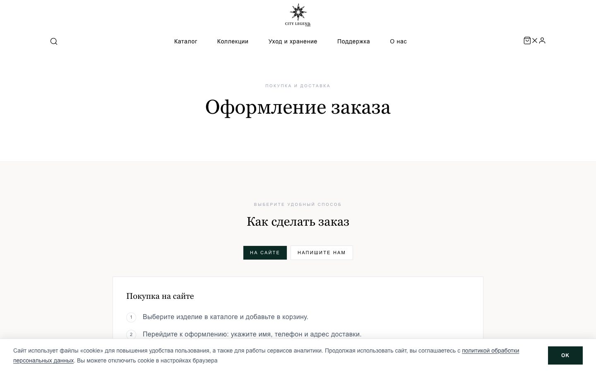
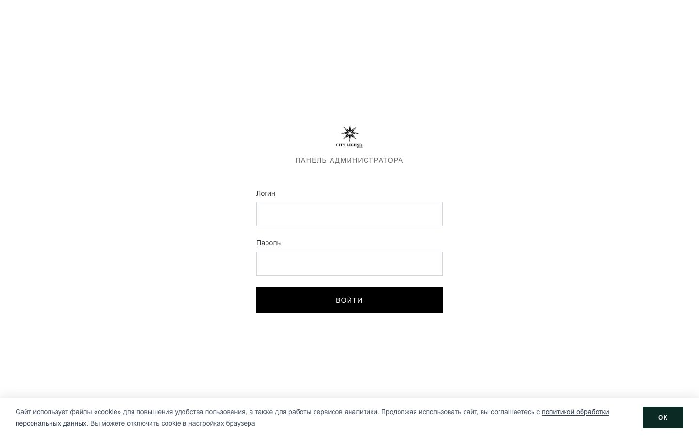
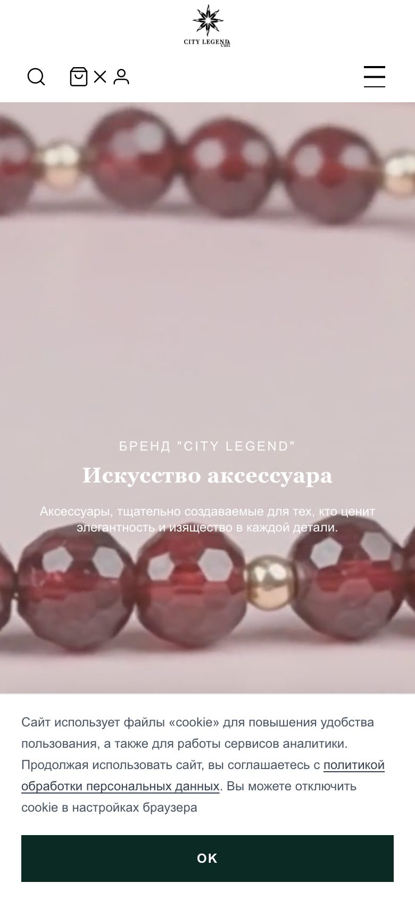

<div align="center">

# City Legend

**A jewelry storefront, an admin CMS and a messenger CRM in one Next.js 16 app.**
43 tables with no ORM, 108 API routes, T-Bank acquiring, live CDEK tariffs, and a
Telegram/MAX bot that pushes lots, coupons and support tickets into the chat where
the customer already lives.

**Live:** [citylegend.art](https://citylegend.art)


</div>

---

<table>
  <tr>
    <td width="50%"></td>
    <td width="50%"></td>
  </tr>
  <tr>
    <td></td>
    <td></td>
  </tr>
  <tr>
    <td></td>
    <td align="center"></td>
  </tr>
</table>

## The problem

A brand that already sells on Wildberries, Ozon and Yandex Market does not need
another "catalog + contact form" site. It needs the things a marketplace refuses
to own: its own product data, its own customer list, its own support channel, and
its own payment rail.

The usual outcome is three disconnected systems — a storefront, an admin that
nobody can use without a developer, and a "CRM" that is a spreadsheet. City Legend
is one deployable app that covers all three, with the messenger as the primary
operator surface: if a ticket, a coupon or a lot card does not reach the client's
chat, it did not happen.

## What this is (and what it isn't)

**It is a production store, not a template.** Real acquiring (T-Bank), real
delivery calculation (CDEK tariffs, addresses, a webhook that writes back to
orders), real inventory, real reviews with SLA-tracked support tickets.

**It is not an ORM app.** Every query is hand-written SQL through `pg`
(`lib/db.ts`, 1,494 lines). The schema is created and migrated at connect time:
43 `CREATE TABLE IF NOT EXISTS` blocks plus 60 additive `ALTER TABLE` statements
and 20 indexes. A fresh database needs one connection, not a migration run.

**It is not a headless CMS.** Content is editable by the client in `/admin` and
lands in `homepage_content`, `about_content`, `site_page_content`,
`cabinet_cms_copy` and `documents` — the site re-renders from those rows.

## The map

```
   public storefront                operator surface              customer cabinet
 ┌───────────────────────┐   ┌───────────────────────────┐   ┌──────────────────────┐
 │ /            homepage │   │ /admin         dashboard  │   │ /login /register     │
 │ /collection  filters  │   │ /admin/edit/*  15 editors │   │ /payment /payment/…  │
 │ /collection/[id] lot  │   │ /admin/crm     customers  │   │ cart · orders ·      │
 │ /promotions/[id]      │   │ /admin/orders · reviews   │   │ favorites · reviews  │
 │ /documents /care      │   │ /admin/bots    broadcasts │   │ /wish/[token] share  │
 │ /how-to-order /promo  │   │ /admin/concierge  tickets │   │ /profile /settings   │
 └───────────┬───────────┘   └────────────┬──────────────┘   └──────────┬───────────┘
             │        108 route handlers · jose JWT · bcryptjs          │
             └───────────────┬──────────────────────────────────────────┘
                    PostgreSQL · 43 tables, schema-on-connect (lib/db.ts)
                             │
        ┌────────────────────┼──────────────────────┬───────────────────────┐
        │                    │                      │                       │
  T-Bank acquiring      CDEK delivery         Telegram + MAX bots      e-mail
  Init/Confirm/Refund   token cache,          broadcast engine,        nodemailer
  signed Token,         tariffs, quotes,      coupon QR, concierge,    (+ HTTPS
  webhook → order       webhook apply         site SSO                 CONNECT proxy)
```

## What makes it different

- **The bot is a first-class channel, not a notification webhook.** Broadcast
  runs, templates with variables, scheduled sends, per-subscriber actions
  (send-lot / send-coupon / send-welcome / text), coupon QR codes and scan
  tracking, unsubscribe, and an export. All of it is driven from `/admin/bots`.
- **Two messengers, one interface.** `lib/bots/telegram.ts` (Telegraf) and
  `lib/bots/max.ts` (MAX platform API) sit behind the same call sites, so staff
  and customer notifications go out over whichever account the user has.
- **RU-network resilience is built in.** Outbound Telegram resolves in three
  steps — Cloudflare Worker relay → HTTPS `CONNECT` proxy via undici → direct
  fetch (`lib/bots/tgFetch.ts`, `deploy/cf-telegram-relay/`). SMTP uses the same
  proxy path (`lib/smtpProxy.ts`), because a socket-level `CONNECT` tunnel is the
  only thing that works where the API is blocked.
- **One-time bot→site SSO.** A deep link from the bot carries a 15-minute token
  (`bot_site_sso_tokens`) that logs the customer straight into their cabinet with
  the coupon or lot already applied — no second password.
- **A bad review opens a ticket by itself.** Rating ≤ 2 triggers
  `openNegativeReviewTicket()`: it binds the review and the order, picks the
  `review_negative` topic, inherits its `sla_minutes`, and notifies the customer
  in the bot. Support does not find out a week later.
- **Volume loyalty from spend, not from points.** `cabinet_loyalty_tiers` holds
  `from_rub → percent` thresholds; the active tier is the highest one the
  customer's lifetime spend has crossed, and the UI shows the next one as
  "remaining ₽".
- **Video posters are generated, not uploaded.** Admins paste an mp4; the client
  extracts one frame, downscales to a 1280px long edge and caches it per video
  (`lib/captureVideoPosterBlob.ts`) — no duplicate JPG to keep in sync in the CMS.
- **Legacy admin passwords migrate themselves.** `admin_users` still has the old
  plaintext column from the previous owner's setup. Login prefers the bcrypt hash
  and refuses plaintext once a hash exists; if only plaintext is present, the
  first successful sign-in hashes it, clears the column, and every login then
  re-clears it. No forced password reset for staff, no dual-format window.
- **Stock is honest.** `computeAvailableUnits()` returns `null` when inventory is
  not tracked, and the UI then says "уточняйте наличие" instead of inventing a
  number.

## Feature map

| Area | Where | What it does |
|---|---|---|
| Catalog + filters | `app/collection`, `lib/ensureCategoryFilters.ts` | price/material/feature filtering over per-category filter definitions; lots fetched in one batch (`CATALOG_FETCH_LIMIT = 500`) |
| Lot page | `lib/auctionDetailPayload.ts` | one loader serves both SSR and API: related lots, collection, category, `compare_at_price` |
| Variants | `lib/productVariants.ts` (328 lines) | option groups — metal, assay, size, chain length — with per-value hints |
| Cart & checkout | `lib/cartPricing.ts`, `lib/cabinetCheckoutResolve.ts` | price + coupon + loyalty applied server-side, availability re-checked at submit |
| Delivery | `lib/cdekClient.ts` (701 lines) | OAuth token cache, tariff choice (door/PVZ), package defaults, flat-rate fallback, quote validation |
| Payment | `lib/tbankAcquiring.ts`, `lib/tbankRefund.ts` | signed `v2/Init`, confirmation records, refund path |
| Orders | `app/api/admin/orders`, `lib/orderNotifyStaff.ts`, `lib/orderNotifyCustomer.ts` | status changes notify both sides |
| Concierge | `lib/conciergeNotifyStaff.ts`, `app/admin/concierge` | topics with SLA, tickets, message threads |
| Reviews | `app/api/*/reviews`, `lib/openNegativeReviewTicket.ts` | verified-purchase reviews, seller replies, auto-ticket on low rating |
| CMS | `lib/homepageContent.ts`, `lib/siteLegal.ts`, `app/admin/edit/*` | homepage blocks, legal texts, documents, blog, promotions |
| SEO | `lib/seo/*`, `app/robots.ts`, `app/sitemap.ts` | Organization/WebSite/Product JSON-LD, per-lot metadata, static page map |
| Cabinet | `lib/auth/cabinetSession.ts` | JWT session, rate-limited login, birth-date and display-name rules |
| Analytics | `recharts` in admin | CRM and bot stats rendered from SQL aggregates |
| Health | `app/api/health/route.ts` | `SELECT 1` probe for UptimeRobot, no internals leaked, `no-store` |

## The signature detail: the T-Bank token

Acquiring rejects a request with "неверный токен" for one reason most
implementations hit: the spec sorts **all** parameters alphabetically and the
password participates in that sort as a normal key. It is not appended at the end.

```ts
// lib/tbankAcquiring.ts
for (const [key, raw] of Object.entries(params)) {
  if (key === 'Token' || key === 'Receipt' || key === 'DATA' || key === 'Password') continue;
  if (raw === undefined || raw === null || raw === '') continue;   // empties excluded
  if (typeof raw === 'object') continue;                            // Receipt is signed separately
  parts[key] = typeof raw === 'boolean' ? (raw ? 'true' : 'false') : String(raw);
}
parts.Password = password;            // then sorted with everything else
const token = sha256(Object.keys(parts).sort().map(k => parts[k]).join(''));
```

Getting this wrong costs a day of "the payment page just errors".

## Stack and size

| 63 437 | 335 | 45 | 108 | 43 | 60 | 20 | 35 |
| --- | --- | --- | --- | --- | --- | --- | --- |
| lines of TS/TSX | source files | pages | API routes | tables | additive ALTERs | indexes | components |

Next.js 16 App Router, `output: 'standalone'`, React Server Components for catalog
and lot pages, client components only where interaction needs them. Tailwind CSS
(582 lines of global CSS — the rest is utility classes), `pg`, `jose`, `bcryptjs`,
`telegraf`, `undici`, `nodemailer` + `resend`, `qrcode`, `leaflet`/`react-leaflet`,
`recharts`. No Prisma, no NextAuth, no Redux, no UI kit.

Server actions run with a 100 MB body limit for media uploads; images are served
through `next/image` with AVIF/WebP and an explicit quality whitelist `[72, 75, 82]`
(Next 16 allows only 75 by default, and the components ask for 72 and 82).

## Run it

```bash
git clone https://github.com/NikitaKoreshkov/city-legend && cd city-legend
npm install
cp .env.example .env      # DATABASE_URL is the only hard requirement
npm run dev               # → http://localhost:3000
```

The schema builds itself on first connection (`ensureDatabase()` in `lib/db.ts`),
so an empty Postgres database is enough to see the site. Optional seeders:

```bash
npm run seed:documents     # legal and offer documents
npm run db:seed-legal      # legal page content
npm run db:sync-homepage-about
```

Without `CDEK_*`, `TBC_*`/`TBANK_*`, `TELEGRAM_BOT_TOKEN` or `MAX_BOT_TOKEN` the
corresponding features disable themselves: catalog, CMS and admin keep working,
quotes return the flat fallback, and bot sends are skipped. That is deliberate —
the store must be reviewable without third-party sandboxes.

## Deploy

`deploy/` holds the production wiring rather than a framework recipe:
`nginx.conf` (the app sits behind it, which is why `middleware.ts` rebuilds the
redirect origin from `x-forwarded-host` instead of trusting `request.nextUrl`),
`tg-polling.js` and `bots-cron.js` for bot long-polling and scheduled broadcasts,
`health-watch.sh`, `harden-server.sh`, `cf-telegram-relay/` (a Wrangler worker),
and `postbuild` → `deploy/sync-next-static.sh` to ship `.next/static` to the host.

## Known limits

- **No automated tests.** Correctness so far comes from running the flows against
  a real database. This is the biggest gap in the repo.
- **Catalog fetches up to 500 lots and filters on the client.** Fine for a jewelry
  assortment of this size, wrong for a supermarket.
- **`/auctions` is a 308 to `/collection`.** The domain model still says "auction"
  in table and file names (`auctions`, `auctionDetailPayload`, `admin/edit/auctions`)
  while the product is a store — renaming was not worth the migration risk.
- **Images live on the same host** under `/uploads/**` (plus a `citylegend.art`
  remote pattern); there is no CDN or object storage in front of them.
- **Admin auth is a single token cookie** checked in middleware with no
  refresh-token rotation, and `/admin/login` has no rate limit of its own
  (the cabinet login does).
- **Personal data is stored in the same database** as everything else, with no
  retention job; a GDPR/KZ-101 deletion path is not implemented.

## Коротко по-русски

Витрина украшений City Legend на Next.js 16: 45 страниц, 108 API-роутов, 43 таблицы
в PostgreSQL без ORM — весь SQL написан вручную в `lib/db.ts`, схема поднимается на
первом подключении (43 `CREATE TABLE IF NOT EXISTS` плюс 60 аддитивных `ALTER TABLE`
и 20 индексов). Главная идея в том, что мессенджер — это рабочий интерфейс магазина,
а не «уведомление на телефон»: из `/admin/bots` запускаются рассылки по шаблонам с
переменными, планировщик, отправка лота и купона с QR-кодом, подписчики и отписки,
а канал один и тот же для Telegram и MAX. Из-за блокировок наружу к Telegram идёт
трёхступенчатый путь: Cloudflare Worker-ретранслятор → HTTPS-CONNECT прокси через
undici → прямой fetch; SMTP использует тот же прокси. Оплата — T-Bank (подпись
токена, где пароль участвует в алфавитной сортировке, иначе «неверный токен»),
доставка — CDEK с кэшем токена, тарифами до двери/пункта и вебхуком, который
дописывает статус заказа. Отзыв с оценкой ≤ 2 сам открывает тикет консьержа с SLA
и уведомляет клиента в боте; лояльность считается порогами от накопленной суммы;
постер для видеоролика берётся из кадра на клиенте и кэшируется, чтобы в CMS не
лежал дублирующий JPG. Автоматических тестов в репозитории нет — это главный долг,
остальное честно проверено на живой базе.

## Rights

© 2026 Nikita Koreshkov. Portfolio piece, all rights reserved. The City Legend
name, product photography, lot data, customer records and marketplace links
belong to the business.
